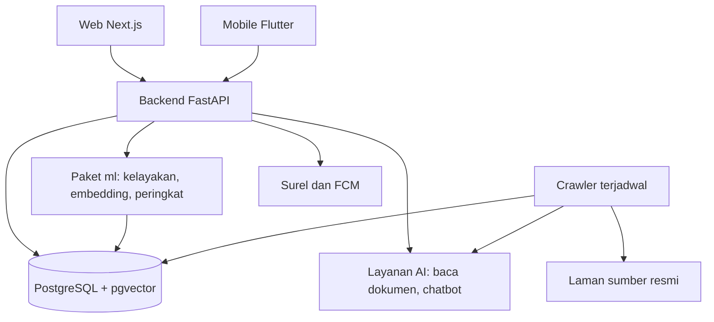

# Arsitektur Sistem SMART

| Atribut | Nilai |
| --- | --- |
| **Versi** | 1.0 |
| **Tanggal** | 2026-10-26 |
| **Status** | Draft |
| **Author** | Tim SMART |
| **Sumber bisnis** | Laporan Inisiasi bagian 5.1 dan 5.2, DP-SM-001 |

## Komponen dan hubungan



Fallback (pembaca tanpa renderer Mermaid):

```text
 Klien                 Server                      Penyimpanan / luar
 Web, Mobile  ---->  Backend FastAPI  ---------->  PostgreSQL + pgvector
                          |  (impor)
                          +--- paket ml ---------->  PostgreSQL (vektor, skor)
                          +--- layanan AI           (baca dokumen, chatbot)
                          +--- surel, FCM           (notifikasi)
 Crawler terjadwal ---------------------------->  PostgreSQL (beasiswa)
        |
        +--- laman sumber resmi, layanan AI (ekstraksi cadangan)
```

## Pembagian tanggung jawab

| Komponen | Boleh | Tidak boleh |
| --- | --- | --- |
| Web dan mobile | Menampilkan data, mengirim input pengguna ke API | Menghitung rekomendasi, memanggil layanan AI langsung |
| Backend | Autentikasi, aturan bisnis, orkestrasi, akses basis data lewat repositori | Mengambil laman sumber (tugas crawler) |
| ml | Menghitung kelayakan, kemiripan, peringkat, alasan | Memanggil layanan AI untuk menentukan peringkat |
| Crawler | Mengambil laman publik terdaftar, ekstraksi, validasi, menulis beasiswa berstatus menunggu | Menerbitkan data yang ditandai meragukan, melewati login, captcha, atau batas laju |
| Layanan AI | Membaca dokumen, ekstraksi cadangan, menjawab dari data yang diberikan | Menerima nama atau tanggal lahir, menentukan peringkat |

## Alur utama

Sama dengan sembilan langkah di DP-SM-001 bagian 1: pemantauan, ekstraksi, validasi admin, profil dan dokumen, pembacaan dokumen, penyusunan rekomendasi, tampilan hasil, chatbot, dan penyimpanan dengan pengingat. Rincian per proses ada di Dokumen Proses Bisnis (M-SM-001 sampai M-SM-008).

## Struktur kode backend

```text
apps/backend/app/
  api/          rute per modul (auth, profil, dokumen, beasiswa, rekomendasi, interaksi, checklist, chat, notifikasi, admin)
  services/     aturan bisnis
  repositories/ akses data (satu-satunya lapisan yang menyentuh basis data)
  models/       model SQLAlchemy
  schemas/      skema Pydantic untuk masukan dan keluaran
  core/         konfigurasi, keamanan, galat, logging
```

Aturan: rute memanggil servis, servis memanggil repositori. Tidak ada kueri di rute. Galat bisnis dilempar sebagai pengecualian domain lalu dipetakan ke kode HTTP di satu tempat (401, 403, 404, 409, 422, bukan 500).

## Keamanan

- Kata sandi di-hash (Argon2 atau bcrypt), token akses berumur pendek dan token penyegar.
- Pemeriksaan kepemilikan pada setiap data pengguna (profil, dokumen, checklist, percakapan).
- Dokumen disimpan terenkripsi; tautan unduhan bertanda tangan dan berumur pendek.
- Batas laju pada login, unggah, dan chatbot.
- Rahasia hanya di `.env` dan penyimpan rahasia host. Lihat `04-Infra/01-LINGKUNGAN-DAN-RAHASIA.md`.
