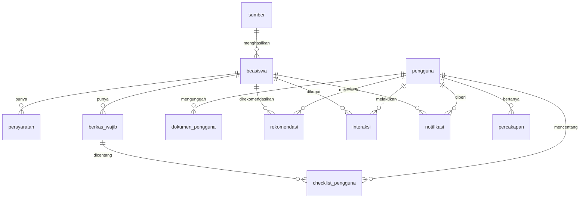

# Skema Basis Data SMART

| Atribut | Nilai |
| --- | --- |
| **Versi** | 1.0 |
| **Tanggal** | 2026-10-26 |
| **Status** | Draft (ERD final menunggu O-03, O-04, O-05) |
| **Author** | Tim SMART |
| **Sumber bisnis** | DP-SM-001 bagian 2 (11 tabel), Laporan Inisiasi bagian 5.3 |

PostgreSQL dengan ekstensi `vector` (pgvector). Nama tabel dan kolom memakai bahasa Indonesia sesuai dokumen kelas. Kunci utama `id` bertipe UUID, `dibuat_pada` dan `diubah_pada` bertipe `timestamptz` di setiap tabel. Enumerasi disimpan sebagai `text` dengan batasan `CHECK`, bukan tipe enum, supaya migrasi nilai baru mudah.

## Diagram relasi



Fallback:

```text
sumber 1---* beasiswa 1---* persyaratan
                     1---* berkas_wajib 1---* checklist_pengguna *---1 pengguna
pengguna 1---* dokumen_pengguna
pengguna *---* beasiswa melalui: rekomendasi, interaksi, notifikasi
pengguna 1---* percakapan
```

## Tabel

### pengguna

| Kolom | Tipe | Aturan |
| --- | --- | --- |
| id | uuid | PK |
| email | text | unik, huruf kecil |
| kata_sandi | text | hash, tidak pernah dikembalikan API |
| peran | text | `mahasiswa` atau `admin` |
| nama | text | |
| tanggal_lahir | date | boleh kosong; tidak dikirim ke layanan AI |
| kota_domisili | text | boleh kosong |
| kampus | text | |
| jenis_kampus | text | `negeri`, `swasta`, boleh kosong |
| program_studi | text | |
| jenjang | text | `D3`, `D4`, `S1`, `S2`, `S3` |
| semester | smallint | 1 sampai 14 |
| ipk | numeric(3,2) | 0 sampai 4 |
| ips_terakhir | numeric(3,2) | 0 sampai 4 |
| minat | text[] | |
| penghasilan_orang_tua | integer | opsional (O-05) |
| skor_bahasa | jsonb | opsional, mis. `{"jenis":"TOEFL","skor":470}` |
| kewarganegaraan | text | opsional |
| vektor_profil | vector(384) | embedding profil; dihitung ulang saat profil berubah |
| preferensi_notifikasi | jsonb | `{"email":true,"push":true}` |

### dokumen_pengguna

| Kolom | Tipe | Aturan |
| --- | --- | --- |
| id | uuid | PK |
| pengguna_id | uuid | FK pengguna, hapus berantai |
| jenis | text | `cv`, `sertifikat`, `pengalaman_organisasi` |
| nama_berkas | text | |
| lokasi_penyimpanan | text | jalur terenkripsi |
| hasil_baca | jsonb | profil terstruktur hasil pembacaan; dapat dikoreksi pengguna |
| status_baca | text | `menunggu`, `selesai`, `gagal` |
| tanggal_unggah | timestamptz | |

Batas unggah: PDF, DOCX, JPG, PNG, maksimal 5 MB.

### sumber

| Kolom | Tipe | Aturan |
| --- | --- | --- |
| id | uuid | PK |
| nama | text | |
| url | text | unik |
| jenis | text | `pantau_otomatis`, `tautan_keluar`, `input_manual`, `rujukan` |
| negara | text | |
| jadwal | text | ekspresi cron, kosong bila tidak dipantau |
| status_terakhir | text | `berhasil`, `gagal`, `belum_pernah` |
| aktif | boolean | |

### beasiswa

| Kolom | Tipe | Aturan |
| --- | --- | --- |
| id | uuid | PK |
| sumber_id | uuid | FK sumber |
| nama | text | |
| penyelenggara | text | |
| negara | text | |
| jenjang | text[] | |
| manfaat | text | |
| tenggat | date | |
| tautan_resmi | text | wajib |
| tanggal_diperiksa | timestamptz | |
| status | text | `menunggu_validasi`, `terbit`, `kedaluwarsa`, `ditolak` |
| alasan_ditandai | text | diisi bila data meragukan |
| sidik_isi | text | hash isi untuk deteksi duplikat dan perubahan |
| vektor | vector(384) | embedding teks beasiswa |

Indeks: `(status, tenggat)`, `(sumber_id)`, indeks vektor HNSW atau IVFFlat pada `vektor`, unik `(sumber_id, sidik_isi)`.

### persyaratan

| Kolom | Tipe | Aturan |
| --- | --- | --- |
| id | uuid | PK |
| beasiswa_id | uuid | FK, hapus berantai |
| jenis | text | `ipk_minimum`, `semester_minimum`, `semester_maksimum`, `jenjang`, `jenis_kampus`, `domisili`, `usia_maksimum`, `sertifikat_bahasa`, `penghasilan_maksimum`, `kewarganegaraan`, `berkas_pendukung`, `lainnya` |
| nilai_batas | jsonb | mis. `{"nilai":3.5}` |
| dapat_dikejar | boolean | penanda syarat yang dapat dipenuhi nanti |

### berkas_wajib

`id`, `beasiswa_id` (FK), `nama_berkas`. Dasar checklist.

### checklist_pengguna

`id`, `pengguna_id`, `berkas_wajib_id`, `selesai` (boolean). Unik `(pengguna_id, berkas_wajib_id)`.

### rekomendasi

| Kolom | Tipe | Aturan |
| --- | --- | --- |
| id | uuid | PK |
| pengguna_id, beasiswa_id | uuid | FK; unik berpasangan |
| skor | numeric(5,4) | 0 sampai 1 |
| skor_kelayakan, skor_kemiripan | numeric(5,4) | komponen skor |
| kategori | text | `memenuhi`, `hampir_memenuhi`, `belum_memenuhi` |
| alasan | jsonb | daftar alasan yang dapat ditampilkan |
| catatan_kekurangan | jsonb | daftar syarat yang kurang beserta selisihnya |
| versi_model | text | untuk penelusuran dan evaluasi |

### interaksi

`id`, `pengguna_id`, `beasiswa_id`, `aksi` (`klik`, `simpan`, `rencana_daftar`), `status_rencana` (`akan_daftar`, `sudah_daftar`, `tidak_jadi`, boleh kosong), `waktu`. Data latih pemeringkatan lanjutan.

### notifikasi

`id`, `pengguna_id`, `beasiswa_id`, `jenis` (`tenggat`, `beasiswa_baru`), `kanal` (`email`, `push`), `waktu_kirim`, `dibaca` (boolean). Unik `(pengguna_id, beasiswa_id, jenis, kanal, tanggal_acuan)` agar pengingat tidak ganda.

### percakapan

`id`, `pengguna_id`, `pesan` (maksimal 2000 karakter), `jawaban`, `rujukan_beasiswa_id` (array uuid), `waktu`.

## Tabel tambahan yang diusulkan

Menunggu keputusan di `00-Cross-Context/05-PERTANYAAN-TERBUKA.md`.

| Tabel | Kolom | Alasan | Butir |
| --- | --- | --- | --- |
| tugas_pribadi | id, pengguna_id, judul, tanggal, selesai | Layar Kalender dan Checklist memuat tugas pribadi | O-03 |
| perangkat_push | id, pengguna_id, token, platform, aktif | Penyimpanan token FCM per perangkat | O-04 |

## Aturan migrasi

1. Semua perubahan skema lewat Alembic; jangan mengubah basis data dengan tangan.
2. Migrasi harus dapat naik dan turun. Uji keduanya pada basis data uji.
3. Nama berkas migrasi: `NNN_deskripsi_singkat.py`. Catat migrasi di entri `apps/docs/version/`.
4. Skrip `seed` hanya `insert` atau `upsert`. Skrip `cleanup` terpisah dan menolak jalan kecuali `APP_ENV` dan daftar putih host terpenuhi (lihat `04-Infra/01-LINGKUNGAN-DAN-RAHASIA.md`).
5. Perubahan tabel yang sudah dipakai kode wajib diikuti penyesuaian dokumen ini dan DP-SM-001 (angka 11 tabel di `docs/` ikut berubah bila tabel bertambah).
