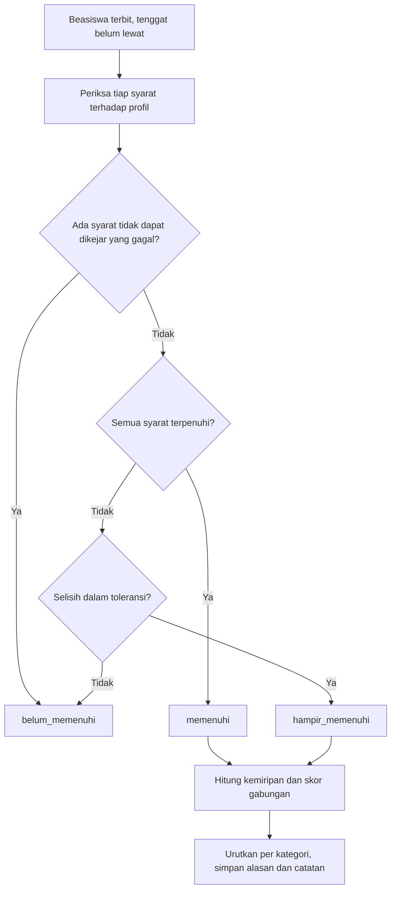

# Aturan Kelayakan dan Model Rekomendasi

| Atribut | Nilai |
| --- | --- |
| **Versi** | 1.0 |
| **Tanggal** | 2026-10-26 |
| **Status** | Draft (batas toleransi ditinjau setelah pengujian) |
| **Author** | Tim SMART |
| **Sumber bisnis** | Laporan Inisiasi bagian 5.4 dan 5.5, DP-SM-001 bagian 4 |

## Tiga lapis

1. **Kelayakan dengan toleransi.** Memeriksa tiap syarat beasiswa terhadap profil.
2. **Kemiripan.** Cosine similarity antara `vektor_profil` dan `beasiswa.vektor` (all-indo-e5-small-v4, 384 dimensi).
3. **Pemeringkatan.** Skor gabungan, lalu LightGBM LambdaMART setelah data interaksi cukup, dengan SHAP untuk penjelasan.

## Kategori

| Kategori | Ketentuan | Tampilan |
| --- | --- | --- |
| memenuhi | Seluruh syarat terpenuhi | Paling atas |
| hampir_memenuhi | Hanya syarat yang dapat dikejar yang belum terpenuhi, dan selisihnya dalam batas toleransi | Dengan catatan kekurangan |
| belum_memenuhi | Ada syarat yang tidak dapat dikejar, atau selisih di luar toleransi | Tidak di rekomendasi utama |

Syarat yang tidak dapat dikejar: domisili, jenis kampus, jenjang, batas usia.

## Batas toleransi awal (konfigurasi)

| Syarat yang dapat dikejar | Batas | Contoh catatan |
| --- | --- | --- |
| IPK minimum | Kurang paling banyak 0,25 | IPK kurang 0,10 dari syarat 3,50 |
| Semester | Kurang paling banyak satu semester | Dapat mendaftar mulai semester 5 |
| Sertifikat bahasa | Belum ada, atau skor kurang paling banyak 10 persen | Perlu skor TOEFL 500, skor saat ini 470 |
| Berkas pendukung | Berkas belum diunggah | Siapkan surat rekomendasi dosen |

Nilai ini disimpan sebagai konfigurasi (`ml/eligibility/config.py` atau berkas YAML), bukan ditulis di tengah logika, supaya mudah ditinjau ulang.

## Rumus

```text
skor = 0,6 x skor_kelayakan + 0,4 x skor_kemiripan
```

`skor_kelayakan` adalah proporsi syarat yang terpenuhi. Syarat yang belum terpenuhi tetapi dalam batas toleransi mendapat nilai sebagian yang berkurang sebanding dengan selisihnya. Syarat yang tidak dapat dikejar dan tidak terpenuhi membuat kategori `belum_memenuhi`.

Skor hanya dipakai untuk mengurutkan di dalam kategori. Skor tidak ditampilkan sebagai persen peluang diterima.

## Urutan penyusunan



Fallback:

```text
1. Ambil beasiswa terbit yang tenggatnya belum lewat
2. Periksa tiap syarat terhadap profil
3. Syarat tidak dapat dikejar gagal         : belum_memenuhi
4. Semua syarat terpenuhi                   : memenuhi
5. Sisanya dalam toleransi                  : hampir_memenuhi
6. Selisih di luar toleransi                : belum_memenuhi
7. Untuk kategori 4 dan 5 hitung kemiripan dan skor gabungan, urutkan, simpan alasan
```

## Alasan dan catatan kekurangan

Setiap hasil menyimpan:

- `alasan`: daftar kalimat singkat, misalnya "Jenjang S1 sesuai", "Minat teknologi mirip dengan fokus beasiswa". Dibuat dari aturan dan fitur teratas SHAP, bukan dari layanan AI.
- `catatan_kekurangan`: untuk `hampir_memenuhi`, daftar syarat yang kurang beserta selisihnya dan saran langkah.

Teks tidak boleh menyatakan pasti diterima atau ditolak.

## Evaluasi

| Ukuran | Target | Cara |
| --- | --- | --- |
| Precision@5 | minimal 0,8 | Gold set (O-07) dibagi pengguna latih dan uji yang terpisah |
| NDCG@5 | dilaporkan | Gold set yang sama |
| Ablasi | dilaporkan | Bandingkan hanya kelayakan, hanya kemiripan, dan gabungan |
| Waktu | 3 detik untuk 1000 beasiswa | Uji kinerja |

Hasil dicatat untuk Laporan Evaluasi (WBS 5.3).

## Pemicu hitung ulang

| Kejadian | Tindakan |
| --- | --- |
| Profil berubah | Hitung ulang `vektor_profil` dan rekomendasi pengguna itu |
| Beasiswa baru terbit atau berubah | Hitung `vektor` beasiswa; rekomendasi pengguna dihitung ulang terjadwal atau saat dibuka |
| Konfigurasi toleransi berubah | Hitung ulang semua dengan `versi_model` baru |
