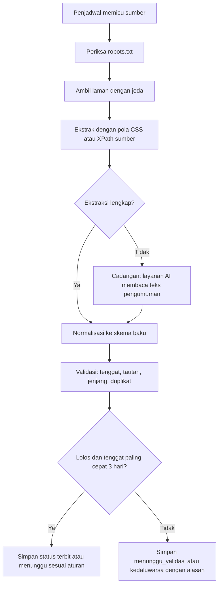

# Pemantauan Sumber Beasiswa

| Atribut | Nilai |
| --- | --- |
| **Versi** | 1.0 |
| **Tanggal** | 2026-10-26 |
| **Status** | Draft |
| **Author** | Tim SMART |
| **Sumber bisnis** | Hasil Riset Data Beasiswa Final (Devan), berkas Link Beasiswa (Riska), DP-SM-001 bagian 3 |

## Metode per sumber

| No | Sumber | Jenis di tabel `sumber` | Metode | Catatan |
| --- | --- | --- | --- | --- |
| 1 | SatuBeasiswa Kemdiktisaintek | pantau_otomatis | Pengambilan terjadwal setelah izin atau API resmi | Data paling lengkap, 17 field per beasiswa; jeda antarpermintaan; antisipasi perubahan struktur |
| 2 | Luarkampus.id | tautan_keluar | Tautan keluar | Detail terkunci login, layanan komersial |
| 3 | Beasiswa Unggulan Kemendikdasmen | tautan_keluar atau input_manual | Dikaji saat F3 | Belum ada hasil riset teknis tersendiri |
| 4 | Kemahasiswaan UIN Malang | pantau_otomatis | Penguraian tabel HTML atau impor sekali jalan | 36 program, kecil dan stabil; validasi tautan |
| 5 | Djarum Beasiswa Plus | input_manual | Input manual dengan tautan resmi | Satu program berupa teks |
| 6 | LPDP Terintegrasi | tautan_keluar | Tautan keluar | Login dengan captcha, tidak dilewati |
| 7 | BSI Scholarship | tautan_keluar | Tautan keluar, kaji ulang | Endpoint data belum terverifikasi, ada batas laju |
| 8 | Komdigi | rujukan | Data historis atau rujukan | Seluruh data selesai dan bertanggal 2024 |
| 9 | Scholarpedia | rujukan | Rujukan skema field | Akses dibatasi; otomatisasi setelah izin |

Butir 3 belum punya hasil riset teknis. Tugas pertama F3 adalah memeriksanya dan memperbarui tabel ini.

## Aturan pengambilan

1. Hanya laman publik resmi yang terdaftar di tabel `sumber`.
2. Periksa `robots.txt` sebelum mengambil; patuhi arahannya.
3. Jeda antarpermintaan ke satu sumber dapat diatur per sumber (nilai awal 5 detik).
4. Tidak melewati login, captcha, atau batas laju. Bila terkena batas laju, berhenti dan jadwalkan ulang.
5. Setiap beasiswa menyimpan `tautan_resmi` dan `tanggal_diperiksa`.
6. Data yang ambigu tidak ditebak. Beasiswa disimpan berstatus `menunggu_validasi` dengan `alasan_ditandai`.

## Alur pemantau



Fallback:

```text
1. Penjadwal memicu satu sumber
2. Cek robots.txt, lalu ambil laman dengan jeda
3. Ekstrak dengan pola sumber. Bila tidak lengkap, layanan AI membaca teks sebagai cadangan
4. Normalisasi ke skema beasiswa dan persyaratan
5. Validasi tenggat, tautan, jenjang, duplikat (sidik_isi)
6. Lolos dan tenggat paling cepat tiga hari : terbit
7. Meragukan atau kurang lengkap            : menunggu_validasi dengan alasan
8. Tenggat lewat                            : kedaluwarsa
```

## Struktur kode crawler

```text
apps/crawler/
  sources/      satu berkas per sumber: URL, pola, frekuensi, jeda
  extract/      pengekstrak, normalisasi, cadangan layanan AI
  validate/     aturan validasi dan deduplikasi
  scheduler.py  penjadwal
  tests/        uji dengan contoh HTML tersimpan di tests/fixtures/
```

## Ketentuan uji

- Setiap sumber punya contoh HTML tersimpan dan hasil ekstraksi yang diharapkan.
- Uji gagal bila hasil ekstraksi nol, supaya perubahan struktur laman terdeteksi.
- Uji tidak boleh mengakses laman sumber sungguhan.

## Laporan sistem

Setiap putaran mencatat sumber, jumlah ditemukan, jumlah terbit, jumlah ditandai, dan galat. Admin melihat ringkasannya (FR-SM-14).
