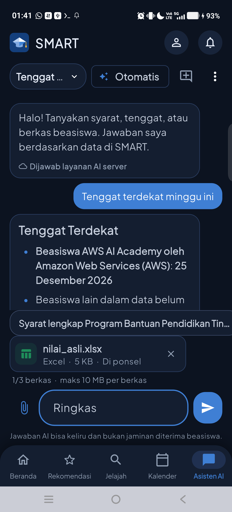
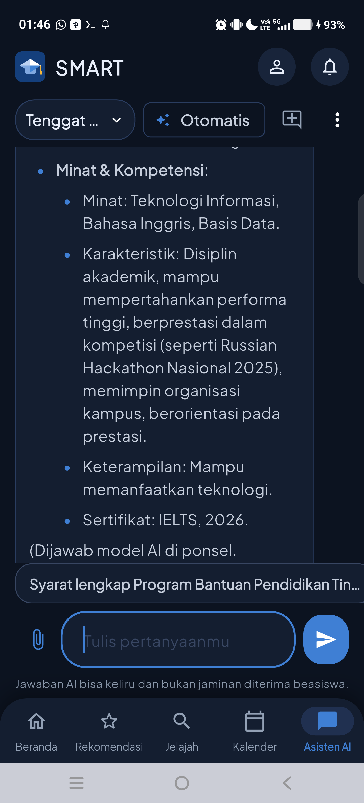
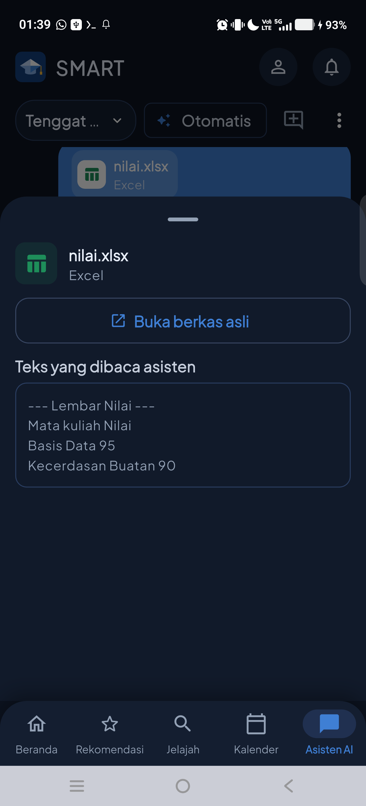
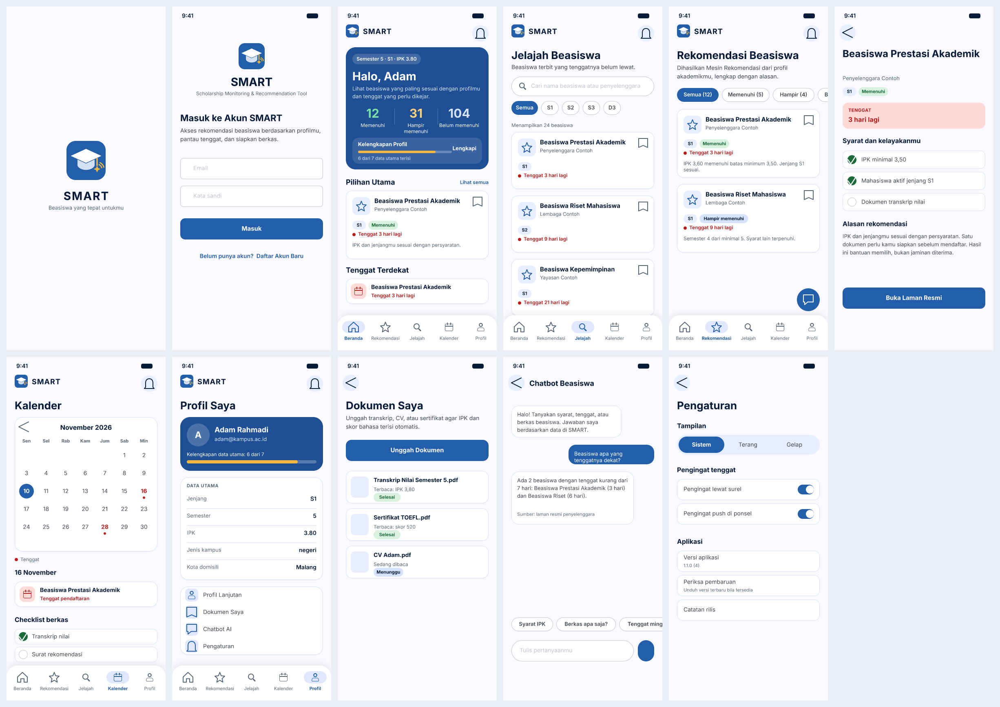
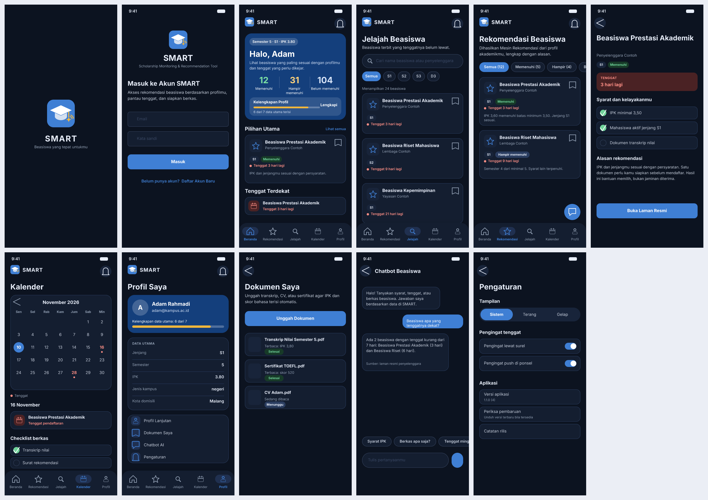

<div align="center">


# SMART

**Scholarship Monitoring and Recommendation Tool**

Sistem Pemantauan dan Rekomendasi Beasiswa Berbasis Machine Learning

[](https://www.python.org/)
[](https://fastapi.tiangolo.com/)
[](https://github.com/pgvector/pgvector)
[](https://nextjs.org/)
[](https://flutter.dev/)
[](https://pub.dev/packages/get)
[](https://lightgbm.readthedocs.io/)

[Web](https://smart-web-three.vercel.app) | [Unduh APK](https://github.com/Sadamdi/smart/releases/latest) | [Rilis](https://github.com/Sadamdi/smart/releases) | [Dokumentasi teknis](Dokument/README.md)

</div>

---

## Tentang Proyek

Informasi beasiswa tersebar di banyak laman, cepat berganti, dan sulit dinilai kecocokannya oleh mahasiswa. **SMART** memantau laman resmi penyelenggara beasiswa di dalam dan luar negeri secara otomatis, menyimpannya sebagai data terstruktur yang divalidasi, lalu merekomendasikan beasiswa dengan machine learning beserta alasannya.

Rekomendasi dibagi tiga kategori: **memenuhi**, **hampir memenuhi** (dengan catatan kekurangan), dan **belum memenuhi**. Setiap beasiswa menyimpan tautan sumbernya. SMART tidak pernah menyatakan mahasiswa pasti diterima atau ditolak, karena angka yang ditampilkan adalah skor kelayakan terhadap syarat yang tercatat, bukan peluang seleksi.

Layanan AI dalam sistem hanya bertugas membaca dokumen mahasiswa, membantu mengekstrak pengumuman sebagai cadangan, dan menjawab chatbot berdasarkan data di basis data. AI tidak menentukan peringkat.

Proyek ini dikerjakan sebagai tugas mata kuliah Manajemen Proyek (Kelompok 8) Program Studi Teknik Informatika, UIN Maulana Malik Ibrahim Malang, Semester Ganjil 2026/2027, dengan metode Waterfall.

---

## Fitur Unggulan

<table>
<tr>
<td width="50%" valign="top">

### Pemantauan Beasiswa Otomatis
- Memantau lebih dari 40 laman resmi dalam dan luar negeri secara terjadwal
- Membaca laman dengan AI, lalu menormalkan ke bentuk baku SMART
- Mematuhi `robots.txt` dan menolak alamat internal (perlindungan SSRF)
- Validasi otomatis oleh AI, dengan antrean tinjauan admin untuk data yang meragukan
- Tenggat hanya dipercaya bila kutipannya benar-benar ada di laman

### Rekomendasi dengan Alasan
- Penilaian kelayakan dengan toleransi (memenuhi, hampir memenuhi, belum memenuhi)
- Kemiripan profil dan beasiswa lewat sentence embedding
- Pemeringkatan skor gabungan, lalu LightGBM LambdaMART
- Setiap hasil disertai alasan dan syarat yang kurang
- Tab beasiswa dalam negeri dan luar negeri, serta skor kelayakan di kartu

### Kalender dan Checklist
- Tenggat beasiswa tersimpan tampil di kalender
- Checklist berkas wajib per beasiswa
- Tugas pribadi (tambah, selesaikan, hapus)
- Notifikasi tenggat lewat push dan surel

</td>
<td width="50%" valign="top">

### Asisten AI
- Chatbot yang menjawab dari data SMART, dengan rujukan sumber
- Jawaban mengalir per potongan (SSE) dan mendukung Markdown
- Banyak sesi percakapan, judul otomatis, saran pertanyaan lanjutan
- Statistik pemakaian per percakapan (token masuk dan keluar)
- Ekspor dan impor riwayat percakapan

### Dokumen dan Memori
- Unggah CV, transkrip, dan sertifikat (PDF, Word, PowerPoint, Excel, gambar, teks)
- Dokumen dibaca AI dan hasilnya bisa dikoreksi
- Lampiran di chat dengan kartu, pratinjau, dan tombol buka berkas asli
- Memori AI tentang pengguna yang bisa dilihat, diubah, dan dimatikan
- Pembersihan otomatis berkas dan memori yang lama tidak terpakai

### Aplikasi Mobile Offline-First
- Mode luring dengan paket data beasiswa di ponsel
- Model AI di ponsel (Gemma) untuk chat tanpa internet
- Membaca dokumen offline: DOCX, PPTX, XLSX, ODF, EPUB, PDF, dan OCR gambar
- Antrean unggah dokumen dan sinkronisasi otomatis saat online
- Pembaruan aplikasi otomatis lewat GitHub Releases

### Panel Admin
- Antrean validasi beasiswa, terbitkan atau tolak dengan alasan
- Manajemen sumber pemantauan dan status terakhirnya
- Laporan ringkas sistem dan saklar validasi AI

</td>
</tr>
</table>

---

## Cara Kerja Rekomendasi

| Lapisan | Fungsi | Lokasi |
| --- | --- | --- |
| 1. Kelayakan | Mencocokkan syarat terukur (IPK, semester, jenjang, bahasa, kewarganegaraan, domisili, dan lain-lain) dengan profil, dengan batas toleransi yang disimpan sebagai konfigurasi | `apps/backend/app/rekomendasi/kelayakan.py` |
| 2. Kemiripan | Sentence embedding (`all-indo-e5-small-v4`) pada profil dan beasiswa, disimpan di pgvector | `apps/backend/app/rekomendasi/embedding.py` |
| 3. Peringkat | Skor gabungan, lalu LightGBM LambdaMART setelah ada data interaksi | `apps/backend/app/rekomendasi/peringkat.py` |

Beasiswa tanpa syarat terukur tidak dinyatakan memenuhi dan tidak diberi angka. Aturan lengkap ada di `Dokument/01-Arsitektur/03-ATURAN-KELAYAKAN-DAN-MODEL.md`.

---

## Arsitektur

```text
+------------------------------------------------------------------+
|  SUMBER DATA                                                     |
|  Laman resmi penyelenggara beasiswa, dalam dan luar negeri       |
+------------------------------------------------------------------+
                               |  dibaca terjadwal (05.30 WIB)
+------------------------------------------------------------------+
|  PEMANTAU DAN VALIDASI (di dalam backend)                        |
|  ambil laman aman, ekstraksi AI, validasi AI, antrean admin      |
+------------------------------------------------------------------+
                               |  beasiswa terbit
+------------------------------------------------------------------+
|  BACKEND  FastAPI /api/v1                                        |
|  autentikasi, kelayakan, embedding, peringkat, chatbot, dokumen  |
|  PostgreSQL + pgvector                                           |
+------------------------------------------------------------------+
            |  REST + JSON                        |  REST + JSON
+---------------------------+        +------------------------------+
|  WEB  Next.js (Vercel)    |        |  MOBILE  Flutter + GetX      |
|  /backend diteruskan      |        |  APK, mode luring, model AI  |
|  ke server API            |        |  di ponsel, baca dokumen     |
+---------------------------+        +------------------------------+
```

### Backend

```text
Python 3.12 + FastAPI
SQLAlchemy 2 + Alembic        migrasi basis data
PostgreSQL + pgvector         data dan vektor embedding
PyJWT + argon2 + cryptography autentikasi dan enkripsi
slowapi                       pembatasan laju permintaan
APScheduler                   pemantauan dan pembersihan terjadwal
LightGBM + NumPy              pemeringkatan
pypdf + Pillow                pembacaan dokumen
httpx                         pengambilan laman dan layanan AI (OpenAI-compatible)
```

### Web

```text
Next.js + React + TypeScript
TanStack Query                pengambilan dan cache data
Tailwind CSS                  gaya
Zod                           validasi skema
Vitest + Testing Library      pengujian
```

### Mobile

```text
Flutter (Dart) dengan GetX    state management dan injeksi dependensi
go_router                     navigasi
dio                           klien REST
flutter_secure_storage        penyimpanan token
flutter_edge_ai_litertlm      model AI di ponsel (Gemma 4)
pdfrx + archive + ML Kit      baca PDF, Office, EPUB, dan OCR secara offline
open_filex + file_picker      buka dan pilih berkas
```

---

## Struktur Proyek

```text
SMART/
├── apps/
│   ├── backend/            API FastAPI
│   │   ├── app/
│   │   │   ├── api/v1/         rute: auth, me, beasiswa, rekomendasi, chat, dokumen, memori, admin
│   │   │   ├── services/       logika: pemantau_ai, chat, dokumen, memori, pembersihan, laman, llm
│   │   │   ├── rekomendasi/    kelayakan, embedding, peringkat, wilayah, statistik
│   │   │   ├── repositories/   akses data
│   │   │   ├── models/ schemas/ core/
│   │   ├── migrations/         Alembic
│   │   ├── scripts/            seed, pantau, validasi, cadangan, evaluasi
│   │   └── tests/              pytest
│   ├── crawler/            Pemantau laman (smart_crawler)
│   ├── ml/                 Paket mesin rekomendasi (smart_ml)
│   ├── web/                Next.js: halaman mahasiswa dan panel admin
│   │   └── src/app/(app)/      beranda, jelajah, rekomendasi, kalender, chat, dokumen, memori, profil, admin
│   ├── mobile/             Flutter
│   │   ├── lib/core/           api_client, router, tema, mode luring (lokal), pembaruan
│   │   ├── lib/features/       auth, beasiswa, beranda, rekomendasi, kalender, chat, dokumen, memori, profil, admin
│   │   ├── release-notes/      catatan tiap rilis
│   │   └── scripts/release.ps1 skrip rilis APK
│   └── docs/               Jejak pengerjaan per fitur (version, todo, features, flows)
├── Dokument/               Dokumen teknis: arsitektur, skema, API, infra, pengujian
├── deploy/                 Templat Nginx dan systemd
├── design/                 Logo, identitas, dan desain UI (smart-ui.figcraft dan render)
└── .github/workflows/      CI
```

---

## Backend (`apps/backend`)

API REST FastAPI yang menjadi satu-satunya pintu data untuk web dan mobile.

### Arsitektur berlapis

```text
HTTP masuk ke api/v1 (rute tipis, validasi Pydantic, autentikasi)
            |
            v
         services (logika bisnis: chat, dokumen, memori, pemantau_ai, pembersihan, rekomendasi)
            |
            v
         repositories (akses data), SQLAlchemy, PostgreSQL + pgvector
            |
            +-- rekomendasi/ (kelayakan, embedding, peringkat)
            +-- llm.py (layanan AI OpenAI-compatible)   +   laman.py (pengambil laman aman)
```

Rute tidak memanggil basis data langsung; semua lewat servis dan repositori. Respons selalu memakai amplop `success`, `data`, `error`.

### Modul

| Folder atau berkas | Tanggung jawab |
| --- | --- |
| `app/main.py` | Membuat aplikasi, memasang router `/api/v1`, CORS, dan penjadwal |
| `app/api/v1/` | `auth`, `me`, `beasiswa`, `rekomendasi`, `aktivitas` (interaksi, kalender, notifikasi), `chat`, `dokumen`, `memori`, `admin`, `referensi`, `health` |
| `app/services/pemantau_ai.py` | Membaca laman sumber, mengikuti tautan detail, validasi AI, sitemap |
| `app/services/chat.py` | Chatbot, sesi, saran lanjutan, statistik, ringkasan percakapan |
| `app/services/dokumen.py` | Penyimpanan, pembacaan AI, batas ruang, pembersihan |
| `app/services/memori.py` | Memori pengguna dari dokumen dan percakapan |
| `app/services/pembersihan.py` | Penghapusan otomatis lampiran dan memori yang tidak terpakai |
| `app/services/laman.py` | Pengambilan laman aman: SSRF, `robots.txt`, batas ukuran |
| `app/rekomendasi/` | `kelayakan`, `embedding`, `peringkat`, `peluang`, `wilayah`, `statistik` |
| `app/core/` | `config`, `security` (JWT, Argon2), `enkripsi`, `ratelimit`, `safety`, `terowongan` |
| `migrations/` | Sepuluh migrasi Alembic (0001 skema awal sampai 0010 pembersihan otomatis) |

### Tabel basis data

| Tabel | Isi |
| --- | --- |
| `pengguna` | Akun dan profil mahasiswa (IPK, semester, jenjang, bahasa, domisili, dan lain-lain) |
| `sumber` | Laman pemantauan, jenis, jadwal, dan status terakhir |
| `beasiswa` | Beasiswa terstruktur dengan status `menunggu_validasi`, `terbit`, `kedaluwarsa`, `ditolak`, serta vektor embedding |
| `persyaratan`, `berkas_wajib` | Syarat terukur dan berkas wajib per beasiswa |
| `rekomendasi` | Hasil penilaian dan peringkat |
| `interaksi` | Klik, simpan, dan rencana daftar (bahan pelatihan peringkat) |
| `checklist_pengguna`, `tugas_pribadi` | Checklist berkas dan tugas pribadi di kalender |
| `dokumen_pengguna` | Dokumen yang diunggah beserta hasil baca dan asalnya (profil atau chat) |
| `sesi_chat`, `percakapan` | Sesi dan riwayat chatbot |
| `memori_pengguna` | Butir memori AI tentang pengguna |
| `notifikasi`, `perangkat_push` | Notifikasi dan token push |
| `pengaturan` | Saklar sistem, misalnya validasi otomatis oleh AI |

### Tugas terjadwal

| Tugas | Jadwal | Fungsi |
| --- | --- | --- |
| Validasi antrean | Tiap 10 menit | Memvalidasi beasiswa menunggu bila saklar validasi AI menyala |
| Pemantauan sumber | Setiap hari 05.30 WIB | Membaca seluruh sumber aktif dan menambah kandidat baru |

---

## Web (`apps/web`)

Aplikasi Next.js untuk mahasiswa dan admin. Seluruh data dimuat di klien dengan TanStack Query setelah token diperiksa.

### Arsitektur

```text
Peramban membuka Next.js (Vercel)
                |  rewrites: /backend/* diteruskan ke BACKEND_ORIGIN   (tanpa CORS dan tanpa campuran HTTP/HTTPS)
                v
             FastAPI /api/v1
```

Komponen halaman memakai hook di `src/lib/hooks.ts` (TanStack Query) yang memanggil klien API di `src/lib/api.ts`. Token disimpan lewat `src/lib/token.ts`, dan `Gerbang.tsx` melindungi halaman yang butuh login.

### Halaman

| Rute | Fungsi |
| --- | --- |
| `/masuk`, `/daftar` | Autentikasi |
| `/` | Beranda: ringkasan rekomendasi dan tenggat dekat |
| `/rekomendasi` | Rekomendasi per kategori, tab dalam dan luar negeri |
| `/jelajah` | Pencarian dan filter beasiswa |
| `/beasiswa/[id]` | Detail, syarat, kekurangan, dan checklist |
| `/tersimpan` | Beasiswa tersimpan |
| `/kalender` | Kalender tenggat dan tugas pribadi |
| `/chat` | Asisten AI dengan sesi, lampiran, saran, dan statistik |
| `/dokumen`, `/memori` | Dokumen dan memori AI |
| `/profil`, `/pengaturan`, `/notifikasi` | Profil, pengaturan, dan notifikasi |
| `/admin` (`antrean`, `sumber`, `laporan`) | Panel admin |

### Komponen dan pustaka

| Berkas | Fungsi |
| --- | --- |
| `AppShell.tsx`, `Gerbang.tsx`, `Providers.tsx` | Kerangka, gerbang login, penyedia query dan tema |
| `KartuBeasiswa.tsx`, `Skor.tsx` | Kartu beasiswa dan cincin skor kelayakan |
| `GelembungChat.tsx`, `TeksMarkdown.tsx`, `PratinjauLampiran.tsx` | Chat, Markdown, dan pratinjau lampiran |
| `KalenderBulan.tsx`, `DaftarChecklist.tsx` | Kalender dan checklist berkas |
| `KolomUnggah.tsx`, `KoreksiHasilBaca.tsx` | Unggah dan koreksi hasil baca dokumen |
| `lib/api.ts`, `hooks.ts`, `types.ts`, `validasi.ts` | Klien API, hook data, tipe, dan validasi formulir |

---

## Mobile (`apps/mobile`)

Aplikasi Flutter Android yang tetap berguna tanpa internet.

### Arsitektur

```text
presentation (halaman + GetxController, state reaktif .obs / Obx)
      |
      v
data (Repository) memakai ApiClient (dio), cache respons, lalu server
      |
      +-- core/lokal (mesin luring di ponsel)
              mesin_lokal: daftar, kalender, rekomendasi saat luring
              kelayakan, peluang, wilayah: aturan yang sama dengan backend
              model_ai: model Gemma di ponsel untuk chat tanpa internet
              ekstrak_teks, ekstrak_dokumen: baca dokumen dan OCR offline
              chat_lokal: riwayat dan statistik chat lokal
```

Setiap fitur dibagi tiga lapis: `domain` (model dengan `fromJson` dan `toJson`), `data` (repository), dan `presentation` (halaman dan controller GetX). Dependensi didaftarkan sekali di `core/dependensi.dart` dengan `Get.put`.

### Fitur

| Fitur (`lib/features/`) | Isi |
| --- | --- |
| `auth` | Masuk, daftar, penyimpanan token aman, sinkronisasi sebelum keluar |
| `beranda`, `rekomendasi`, `beasiswa` | Beranda, rekomendasi, jelajah (cari dan filter), detail, tersimpan |
| `kalender` | Tenggat, checklist berkas, dan tugas pribadi |
| `chat` | Asisten AI (server atau ponsel), sesi, lampiran, saran, statistik |
| `dokumen`, `memori` | Dokumen profil, antrean unggah, ruang penyimpanan, memori AI |
| `profil`, `pengaturan`, `notifikasi` | Profil dan profil lanjutan, tema, model AI, mode luring, notifikasi |
| `admin` | Antrean validasi dan sumber untuk admin |

### Inti (`lib/core/`)

| Berkas | Fungsi |
| --- | --- |
| `api_client.dart` | Klien REST (GET, POST, PUT, PATCH, DELETE), penyegaran token, antrean tulis saat luring |
| `cache_lokal.dart` | Cache respons GET agar data terakhir tetap terbaca tanpa jaringan |
| `router.dart` | Navigasi `go_router` dengan pengalihan sesuai status login |
| `async_state.dart`, `widgets/state_widgets.dart` | Status memuat, sukses, dan gagal beserta tampilannya |
| `terowongan.dart` | Terowongan terenkripsi tambahan di atas HTTPS (kunci publik X25519) |
| `update/` | Pemeriksaan dan pemasangan pembaruan APK otomatis |
| `theme/`, `tema_controller.dart` | Tema terang, gelap, atau ikut sistem |
| `lokal/` | Mesin luring, model AI di ponsel, dan pembaca dokumen offline |

### Pemetaan ke ketentuan praktikum

Aplikasi ini juga dipakai untuk UAS Praktikum Mobile Programming. State management memakai **GetX** (13 `GetxController`, `.obs`, `Obx`), data dari **REST API** lewat dio dengan **CRUD** penuh, **Model class** dengan `fromJson` dan `toJson` di `features/*/domain`, **async** dengan `Future`, `async`, dan `await` beserta penanganan loading dan galat, **form dengan validasi** di Masuk, Daftar, dan Profil, serta fitur tambahan berupa pencarian, filter, mode gelap, chatbot, dan mode luring.

---

## Tangkapan Layar

Aplikasi mobile berjalan di ponsel dengan mode pesawat, membaca lampiran di ponsel dan menjawab dengan model AI lokal:

<p align="center">
  
  
  
</p>

Rancangan antarmuka (file `design/smart-ui.figcraft`):

<p align="center">
  
  
</p>

<p align="center">
  
</p>

---

## Memulai

### Prasyarat

- Python 3.12 dan [uv](https://docs.astral.sh/uv/)
- Node.js (versi LTS) dan npm
- Flutter SDK dengan Dart 3.13 atau lebih baru (untuk mobile)
- PostgreSQL dengan ekstensi pgvector (proyek ini memakai Supabase)
- Kunci layanan AI yang kompatibel dengan OpenAI (untuk pembacaan dokumen, validasi, dan chatbot)

### Instalasi

```powershell
git clone https://github.com/Sadamdi/smart.git
cd smart
```

**Backend**

```powershell
cd apps/backend
copy .env.example .env           # isi nilainya, lihat tabel di bawah
uv sync --python 3.12
uv run alembic upgrade head      # migrasi basis data
uv run python -m scripts.seed_sumber   # daftar sumber pemantauan
uv run uvicorn app.main:app --reload --port 8000
```

Swagger tersedia di `http://localhost:8000/docs`.

**Web**

```powershell
cd apps/web
copy .env.example .env.local     # NEXT_PUBLIC_API_URL
npm install
npm run dev
```

**Mobile**

```powershell
cd apps/mobile
flutter pub get
flutter run --dart-define=API_BASE_URL=http://10.0.2.2:8000/api/v1
```

`10.0.2.2` adalah alamat komputer dari emulator Android. Untuk ponsel sungguhan, isi dengan alamat server yang dapat dijangkau.

### Variabel Lingkungan (backend)

| Variabel | Fungsi |
| --- | --- |
| `APP_ENV` | `dev`, `test`, atau `prod`. Skrip yang menghapus data menolak jalan di `prod` |
| `DATABASE_URL` | Alamat PostgreSQL |
| `DESTRUCTIVE_DB_HOSTS` | Daftar putih host yang boleh dihapus datanya (kosong di produksi) |
| `CORS_ORIGINS` | Asal web yang diizinkan |
| `JWT_SECRET`, `JWT_ACCESS_MENIT`, `JWT_REFRESH_HARI` | Pengaturan token |
| `ENCRYPTION_KEY` | Kunci enkripsi data sensitif |
| `AI_BASE_URL`, `AI_API_KEY`, `AI_MODEL`, `AI_MODEL_GAMBAR`, `AI_BATAS_HARIAN` | Layanan AI dan batas pemakaian harian |
| `SMTP_HOST`, `SMTP_USER`, `SMTP_PASSWORD`, `SMTP_DARI` | Surel notifikasi |
| `FCM_CREDENTIALS_PATH` | Kredensial push notification |

Berkas `.env` tidak boleh masuk repositori. Hanya `.env.example` yang disimpan.

### Skrip Backend

Dijalankan dari `apps/backend` dengan `uv run python -m scripts.<nama>`.

| Skrip | Fungsi |
| --- | --- |
| `seed_sumber` | Membuat atau memperbarui daftar sumber pemantauan |
| `pantau_sekarang` | Menjalankan pemantauan sekarang |
| `validasi_semua` | Memvalidasi seluruh antrean menunggu (`--ulang` membuka kembali yang gagal sementara) |
| `rapikan_penyelenggara`, `normalisasi_nama` | Menyeragamkan penulisan penyelenggara dan nama beasiswa |
| `cadangan` | Mencadangkan data |
| `evaluasi_peringkat`, `latih_peringkat`, `gold_set` | Evaluasi dan pelatihan pemeringkatan |

---

## Pengujian dan CI

| Komponen | Perintah | Cakupan |
| --- | --- | --- |
| Backend | `cd apps/backend && uv run pytest` | Aturan kelayakan, API, chat, dokumen, pembersihan (271 tes) |
| Web | `cd apps/web && npm test` | Halaman dan komponen (53 tes) |
| Mobile | `cd apps/mobile && flutter analyze && flutter test` | Layar, model JSON, gerbang overflow (131 tes) |
| Crawler dan ML | `uv run pytest` di `apps/crawler` dan `apps/ml` | Pemantau dan mesin rekomendasi |

Tes yang menyentuh basis data otomatis dilewati di CI dan di `APP_ENV=prod`. CI GitHub Actions menjalankan tujuh pemeriksaan pada setiap pull request: backend, crawler, ml, mobile, web, pemindaian rahasia, dan GitGuardian.

---

## Dokumentasi API

Semua rute berada di bawah `/api/v1`. Dokumentasi interaktif ada di `/docs`.

| Kelompok | Rute utama |
| --- | --- |
| Autentikasi | `POST /auth/register`, `/auth/login`, `/auth/refresh`, `/auth/logout` |
| Akun dan profil | `GET /me`, `PUT /me/profil`, `PUT /me/preferensi-notifikasi`, `GET /me/ekspor`, `DELETE /me` |
| Beasiswa | `GET /beasiswa`, `GET /beasiswa/{id}`, `POST /beasiswa/{id}/interaksi`, `DELETE /beasiswa/{id}/interaksi/simpan`, `GET /beasiswa/sinkron` |
| Rekomendasi | `GET /rekomendasi`, `GET /rekomendasi/ringkasan`, `POST /rekomendasi/hitung-ulang` |
| Tersimpan dan kalender | `GET /me/tersimpan`, `GET /me/kalender`, `POST/PUT/DELETE /me/tugas`, `PUT /me/checklist/{id}` |
| Notifikasi | `GET /notifikasi`, `PUT /notifikasi/{id}/baca`, `PUT /notifikasi/baca-semua` |
| Chatbot | `GET /chat/status`, `POST /chat/stream`, `GET /chat/riwayat`, `GET/POST /chat/sesi`, `PATCH/DELETE /chat/sesi/{id}`, `GET /chat/saran`, `GET /chat/statistik`, `GET /chat/ekspor`, `POST /chat/impor` |
| Dokumen | `GET/POST /me/dokumen`, `GET /me/dokumen/{id}`, `GET /me/dokumen/{id}/berkas`, `PUT /me/dokumen/{id}/hasil-baca`, `DELETE /me/dokumen/{id}`, `GET /me/dokumen/penyimpanan` |
| Memori | `GET/POST/DELETE /me/memori`, `PATCH/DELETE /me/memori/{id}`, `PUT /me/memori/pengaturan`, `GET /me/memori/statistik` |
| Admin | `GET /admin/antrean-validasi`, `PUT /admin/beasiswa/{id}`, `POST /admin/beasiswa/{id}/terbitkan`, `POST /admin/beasiswa/{id}/tolak`, `GET/POST/PUT /admin/sumber`, `GET /admin/laporan`, `GET/PUT /admin/pengaturan` |
| Infrastruktur | `GET /health`, `GET /health/siap` |

Respons memakai amplop `{ "success": true, "data": ... }`. Galat berbentuk `{ "success": false, "error": { "code", "message" } }`.

---

## Alur Penting

### Mode luring dan sinkronisasi (mobile)
Ponsel mengunduh paket data beasiswa. Saat tidak ada internet, daftar, kalender, dan rekomendasi dihitung di ponsel oleh mesin lokal yang selaras dengan mesin Python. Perubahan yang dibuat saat luring diantrekan dan dikirim begitu jaringan kembali.

### Lampiran dokumen di chat
Saat online, berkas jenis yang dikenali server (PDF, DOCX, TXT, PNG, JPG) diunggah dan dibaca server. Saat luring, atau untuk jenis lain, berkas dibaca di ponsel dan teksnya disisipkan ke konteks model AI di ponsel. Berkas yang dikenali server tetap diantrekan agar terunggah otomatis saat online. Satu pesan maksimal 3 berkas, masing-masing 10 MB.

### Pembersihan otomatis
Lampiran chat dihapus setelah 30 hari tidak dipakai (7 hari bila ruang lebih dari 80 persen penuh). Dokumen profil tidak pernah dihapus otomatis. Memori otomatis yang tidak dipakai 30 hari dinonaktifkan, dengan batas 200 butir. Batas ruang server 500 MB.

### Pemantauan dan validasi
Pemantau membaca laman sumber dengan AI, mengikuti tautan detail dari laman daftar, lalu menyimpan kandidat sebagai menunggu validasi. Validasi AI memeriksa isi laman, tenggat berkutipan, jenjang perkuliahan, dan tautan. Hasilnya terbit, kedaluwarsa, ditolak, atau tetap menunggu untuk ditinjau admin.

---

## Keamanan

- Kata sandi di-hash dengan Argon2; token akses berumur pendek dengan token penyegar yang dapat dicabut
- Pembatasan laju permintaan pada endpoint sensitif
- Data pengguna dapat diekspor dan akun dapat dihapus beserta datanya
- Pengambilan laman hanya http dan https, menolak alamat internal, mematuhi `robots.txt`, dan membatasi ukuran
- Isi laman dan dokumen diperlakukan sebagai data tidak tepercaya, bukan perintah
- Pembaruan APK hanya dari GitHub lewat HTTPS, dengan pemeriksaan SHA-256 dan kunci penandatangan
- Rahasia tidak disimpan di repositori; pemindaian rahasia berjalan di CI
- Skrip yang menghapus data menolak jalan di produksi dan di host di luar daftar putih

---

## Rilis dan Pembaruan Otomatis

Aplikasi mobile dirilis sebagai APK arm64 dan arm32 di [GitHub Releases](https://github.com/Sadamdi/smart/releases). Aplikasi membaca `latest.json`, menawarkan pembaruan, mengunduh APK yang sesuai, memeriksa SHA-256 dan tanda tangan, lalu menyerahkannya ke pemasang Android.

```powershell
cd apps/mobile
.\scripts\release.ps1 -Type patch     # atau minor
```

Catatan rilis ditulis di `apps/mobile/release-notes/` dan tidak boleh memuat tanda kutip ganda. Panduan lengkap: [`apps/mobile/RELEASING.md`](apps/mobile/RELEASING.md).

APK uji untuk server sendiri harus dibangun dengan `--dart-define=API_BASE_URL=<alamat API>` dan `--dart-define=UPDATE_MANIFEST_URL=<alamat latest.json>`.

---

## Dokumen Manajemen Proyek

Sebagai tugas mata kuliah Manajemen Proyek, proyek ini disertai dokumen proposal, project charter, WBS, laporan inisiasi, rencana anggaran biaya, proses bisnis, perancangan sistem, laporan kemajuan, dan laporan pengujian. Rentang proyek 15 September sampai 8 Desember 2026 (13 minggu) dengan metode Waterfall, dan jadwal dikelola di Kaneo. Dokumen tersebut disimpan terpisah oleh tim dan tidak dipublikasikan di repositori ini.

Dokumen teknis untuk pengembang (arsitektur, skema, kontrak API, infrastruktur, pengujian) ada di [`Dokument/`](Dokument/README.md).

---

## Navigasi Dokumentasi

| Kebutuhan | Baca |
| --- | --- |
| Arsitektur, skema, API, infra, pengujian | [`Dokument/README.md`](Dokument/README.md) |
| Rencana pembangunan bertahap | [`Dokument/00-Cross-Context/02-MASTER-PLAN-PEMBANGUNAN.md`](Dokument/00-Cross-Context/02-MASTER-PLAN-PEMBANGUNAN.md) |
| Aturan kelayakan dan model | [`Dokument/01-Arsitektur/03-ATURAN-KELAYAKAN-DAN-MODEL.md`](Dokument/01-Arsitektur/03-ATURAN-KELAYAKAN-DAN-MODEL.md) |
| Aturan pengembangan aplikasi | [`apps/README.md`](apps/README.md) |
| Penempatan di server | [`deploy/README.md`](deploy/README.md) |
| Desain dan identitas | [`design/README.md`](design/README.md) |

---

## Status

Per 24 November 2026: aplikasi web, mobile, dan backend sudah berjalan. Aplikasi mobile rilis 1.14.2, web di Vercel, dan API di server sendiri. Sekitar 240 beasiswa berstatus terbit dari lebih dari 40 sumber terdaftar, dan jumlahnya terus berubah mengikuti pemantauan.

---

## Tim

| Nama | Peran |
| --- | --- |
| Sulthan Adam Rahmadi | Manajer proyek, backend, mobile, mesin rekomendasi, dan chatbot |
| Nur Azizah Riska Rajabiy | UI/UX dan frontend web |
| Devandriya Athallah Putrayana | Data: pemantauan, pengisian, dan validasi beasiswa |

Dosen pengampu: Dr. Fachrul Kurniawan, ST., M.MT., IPU.

---

## Berkontribusi

1. Satu tugas Kaneo per fitur atau perbaikan, dengan judul berawalan `[BE]`, `[FE]`, `[ML]`, atau `[CRAWLER]`.
2. Buat cabang dari `testing`, ajukan pull request ke `testing`, lalu `testing` ke `main` setelah semua pemeriksaan CI lulus.
3. Pesan commit memakai Conventional Commits, subjek di bawah 72 karakter. Tanpa baris atribusi AI pada commit, pull request, maupun dokumen.
4. Lapisan backend: rute, servis, lalu repositori. Rute tidak memanggil basis data langsung.
5. Jangan menulis kunci API, token, atau kredensial ke repositori.
6. Jalankan uji dan pemeriksaan gaya kode modul yang diubah sebelum meminta tinjauan.

## Batasan

SMART bukan sistem pendaftaran beasiswa, tidak memverifikasi keaslian dokumen, dan tidak pernah menyatakan mahasiswa pasti diterima atau ditolak.
