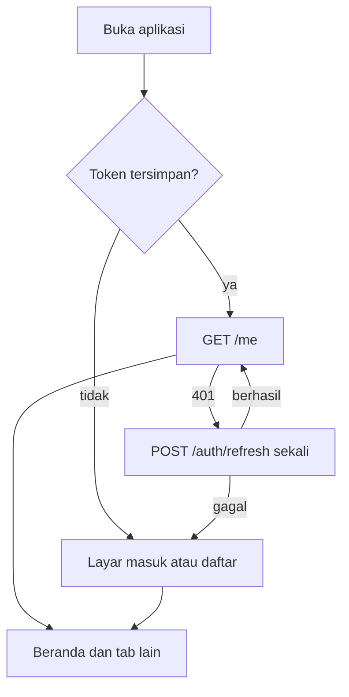

# Fitur: Aplikasi mobile mahasiswa

| Atribut | Nilai |
| --- | --- |
| **Versi** | 1.0 |
| **Tanggal** | 2026-11-03 |
| **Status** | Active |
| **Author** | Tim SMART |
| **Sumber bisnis** | FR-SM-05, 09, 10, 12, 13; `Dokument/03-Frontend/03-RENCANA-UIUX-DARI-FIGMA.md` |
| **Area** | 09-mobile |
| **Kepercayaan kontrak** | Diverifikasi dari kode dan `openapi.json` |
| **Peran** | Mahasiswa |

## Ringkasan

Aplikasi Android (Flutter) untuk mahasiswa. Menampilkan rekomendasi beasiswa dari Mesin Rekomendasi dengan kategori memenuhi, hampir memenuhi, belum memenuhi beserta alasan dan catatan kekurangan, menjelajah beasiswa terbit, menyimpan beasiswa, mencentang berkas, dan menerima notifikasi tenggat. Pendaftaran tetap dilakukan di laman resmi penyelenggara.

## Alur kerja fitur



Fallback (pembaca tanpa renderer Mermaid):

```text
 Aplikasi              API
   | GET /me ---------->|
   |<-- 401 ------------|
   | POST /auth/refresh>|   (satu kali, permintaan lain menunggu)
   |<-- token baru -----|
   | GET /me (ulang) -->|
   |<-- 200 ------------|
   Bila refresh gagal: token dihapus, kembali ke layar masuk.
```

## Aturan bisnis

| ID | Aturan | Sumber |
| --- | --- | --- |
| BR-01 | Tidak ada persen kecocokan, kata "pencocokan", atau klaim peluang lolos di antarmuka | Keputusan dosen 8 Oktober 2026 |
| BR-02 | Rekomendasi selalu disertai alasan dan catatan kekurangan | PRD web dan mobile |
| BR-03 | Tidak ada data contoh fiktif; semua data dari API | Rencana UI/UX |
| BR-04 | Tautan resmi dibuka di aplikasi peramban luar, klik dicatat sebagai interaksi | PRD web dan mobile |

## Endpoint dan tabel

| Metode | Jalur | Peran | Layar |
| --- | --- | --- | --- |
| POST | `/auth/login`, `/auth/register`, `/auth/refresh`, `/auth/logout` | Publik atau Mahasiswa | Masuk, Daftar, Profil (keluar) |
| GET, PUT | `/me`, `/me/profil` | Mahasiswa | Beranda, Profil |
| GET | `/beasiswa`, `/beasiswa/{id}` | Mahasiswa | Jelajah, Detail |
| POST, DELETE | `/beasiswa/{id}/interaksi`, `/interaksi/simpan` | Mahasiswa | Jelajah, Detail, Rekomendasi |
| GET, POST | `/rekomendasi`, `/rekomendasi/ringkasan`, `/rekomendasi/hitung-ulang` | Mahasiswa | Beranda, Rekomendasi |
| GET, PUT | `/me/tersimpan`, `/me/checklist`, `/me/kalender` | Mahasiswa | Kalender, Detail |
| POST, PUT, DELETE | `/me/tugas` | Mahasiswa | Kalender |
| GET, PUT | `/notifikasi`, `/notifikasi/{id}/baca`, `/notifikasi/baca-semua` | Mahasiswa | Notifikasi |

## Cara uji

```text
cd apps/mobile
flutter pub get
dart format lib test
flutter analyze
flutter test
flutter run --dart-define=API_BASE_URL=http://10.0.2.2:8000/api/v1
```

Jalur gagal yang diuji: kredensial salah, galat jaringan dengan tombol coba lagi, daftar kosong, 401 dengan penyegaran, penyegaran gagal.

## Keterbatasan dan hal yang belum dibuat

- Dokumen Saya, Chatbot, dan Pengaturan belum ada di mobile (tahap lanjut menurut peta layar).
- Kalender, Profil, dan Notifikasi disusun dari rencana UI/UX karena frame Figma belum terbaca; perlu dibandingkan dengan Figma.
- Belum diuji di emulator terhadap backend nyata.
- Tema gelap tidak dibangun (tidak ada di Figma).
