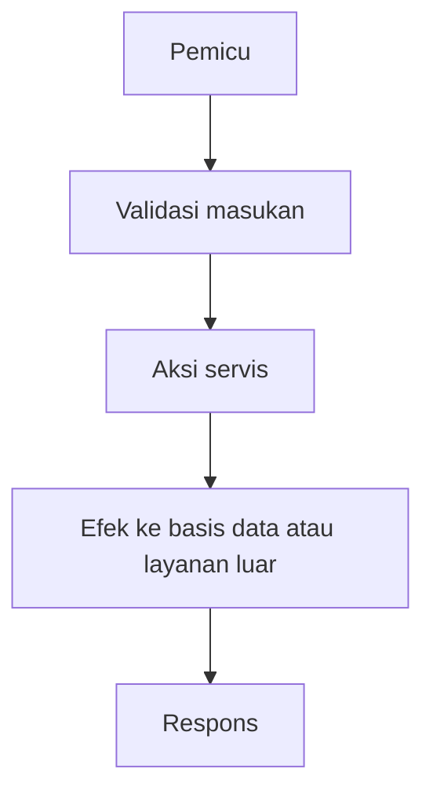

# Templat Dokumen Fitur

Salin ke `apps/docs/features/<NN-area>/<N>. <nama-kebab>.md`. Semua kontrak berasal dari kode, OpenAPI, atau verifikasi saat dijalankan; jangan memakai contoh generik.

---

# Fitur: [Nama fitur]

| Atribut | Nilai |
| --- | --- |
| **Versi** | 1.0 |
| **Tanggal** | YYYY-MM-DD |
| **Status** | Draft / Active / Completed / Deprecated |
| **Author** | Tim SMART |
| **Sumber bisnis** | Proses M-SM-xxx, FR-SM-xx |
| **Area** | NN-area |
| **Kepercayaan kontrak** | Diverifikasi dari kode / Sebagian dari kode / Perlu verifikasi |
| **Peran** | Publik / Mahasiswa / Admin |

## Ringkasan

Apa fitur ini dan untuk siapa, berdasarkan implementasi aktual.

## Alur kerja fitur

Wajib. Jelaskan cara kerja untuk orang yang belum membaca kode.



Fallback (pembaca tanpa renderer Mermaid):

```text
 Klien                 API                       Basis data / layanan
   | METODE /jalur ---->|                              |
   |                    |-- baca atau tulis ---------->|
   |<-- respons --------|                              |
```

## Aturan bisnis

| ID | Aturan | Sumber |
| --- | --- | --- |
| BR-01 | ... | BR-SM-xx di Probis |

## Endpoint dan tabel

| Metode | Jalur | Peran | Tabel |
| --- | --- | --- | --- |

## Cara uji

Perintah atau langkah, termasuk jalur gagal dan uji dua pengguna.

## Keterbatasan dan hal yang belum dibuat
